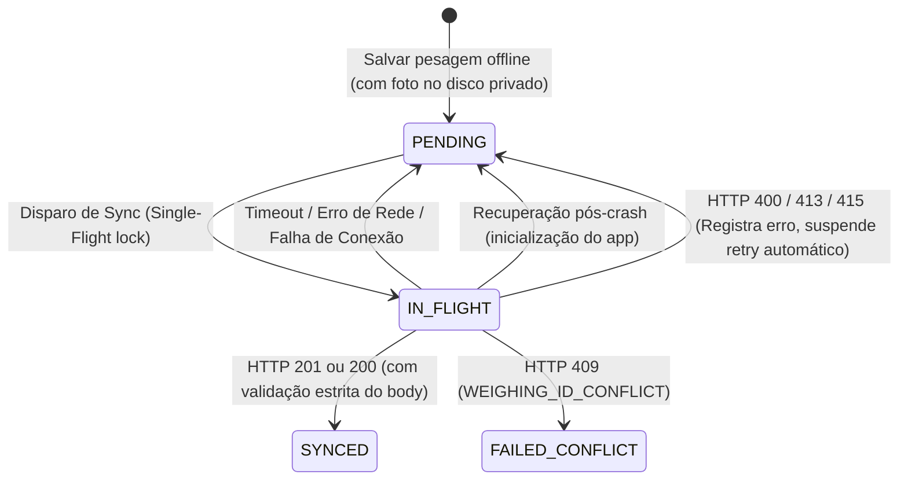

# Arquitetura e Design Offline-First — AgroTrac Mobile

> **Documento Oficial de Engenharia e Arquitetura**  
> **Módulo:** `agrotrac-mobile` (Aplicativo de Campo do Operador de Balança)  
> **Status:** Revisado pela coordenação; correções vinculantes abaixo prevalecem.  
> **Autor:** Arquiteto AgroTrac  
> **Data:** Novembro de 2026  
> **Destinatário:** Desenvolvedor / Agente Codex (Mobile)

---

## Revisão vinculante da coordenação — 16/11/2026

- Não fixar SDK por memória nem usar a menção antiga a SDK 51 como seleção atual. Confirmar compatibilidade nas fontes oficiais e usar APIs homologadas ao SDK escolhido; expo-file-system moderno e legado não são intercambiáveis. O local de persistência é o diretório privado de documentos da API efetivamente adotada.
- Salvar payload canônico imutável e os metadados da foto (SHA-256, bytes, MIME, dimensões quando disponíveis) antes de disponibilizar o registro para sync. Não alterar bytes/extensão da foto depois do primeiro envio. Rejeitar tamanho/dimensões incompatíveis antes de salvar; qualquer transformação de imagem deve ocorrer antes da criação do snapshot e sem apagar a fonte.
- Confirmação SYNCED exige comparar todos os campos canônicos enviados e hash/tamanho/MIME com a resposta, além de validar local_id, sequence decimal positiva e received_at UTC. Status 200 com ID correto e conteúdo ou foto divergente não é confirmação. Headers multipart boundary são gerados pelo fetch/FormData, nunca fixados manualmente.
- Persistir next_attempt_at e auto_retry_blocked (ou equivalente). Erros permanentes 400/413/415 e auth 401/403 não entram novamente na seleção automática em novos eventos de rede/AppState. Conflito 409 fica visível sem retry cego. Preservar dados; não liberar edição de snapshot já enviado nem criar UUID novo silenciosamente. UI de auth deve informar falha de acesso/configuração, sem exigir Gateway anônimo ou expor detalhes internos ao operador.
- Single-flight deve liberar a trava em finally, persistir IN_FLIGHT antes do envio e restaurar após crash somente na inicialização única. Novos registros salvos enquanto há rede disparam sync; eventos coalescidos durante envio geram nova drenagem ao final se necessário. Em rede local isInternetReachable=null não comprova ausência do backend: não impedir sync manual apenas por falta de sonda externa. O app não promete sync encerrado.
- Uma pesagem SYNCED não é reenviada pelo botão de sincronizar. O passo 4 do roteiro abaixo deve comprovar ausência de novo POST para registros já sincronizados; replay 200 é testado no cenário de confirmação perdida com registro ainda pendente.
- Usar constraints SQLite para pesos/estados seguros e transições condicionais; migrações versionadas conhecidas e aditivas, sem exigir que toda evolução se limite a ADD COLUMN. Teste SQLite Node não equivale a executar expo-sqlite no Android; distinguir as evidências.
- Câmera deve ser usada efetivamente para o aceite nativo; galeria é complementar. Permissões negadas/cancelamento precisam manter o formulário funcional e não criar pesagem incompleta. Não prometer JPEG pelo nome do arquivo; preservar MIME/formato real PNG/JPEG.
- A URL do produto aponta ao Gateway configurável. Como o Gateway ainda não foi implementado, um teste de contrato direto ao Audit é verificação técnica parcial, não integração final do aplicativo. Android 10.0.2.2 é alias do host no emulador oficial; adb reverse também pode existir, sem presumir conectividade. Configuração cleartext de desenvolvimento precisa usar plugin/API de configuração oficial compatível, não assumir que android.useCleartextTraffic é chave válida no app.json.

---

## 1. Visão Geral e Princípios Arquiteturais

O aplicativo `agrotrac-mobile` atende operadores de balança e motoristas em locais de recepção de grãos, onde a cobertura de rede de dados celulares e Wi-Fi é frequentemente intermitente ou inexistente.

A arquitetura adota o modelo **Offline-First Descomplicado (Opção 1)**, sem introduzir complexidade desnecessária ou acoplamento a serviços de nuvem:
1. **Autonomia Local Total**: Qualquer pesagem e captura de romaneio é persistida localmente com garantia de durabilidade antes de qualquer tentativa de envio à rede.
2. **Imutabilidade e Idempotência**: No momento da criação da pesagem, é gerado um UUID v4 canônico (`local_id`) estável. O payload estruturado e o arquivo da foto do romaneio formam um snapshot imutável. Reenvios, retries de conexão ou falhas de transmissão utilizam estritamente o mesmo `local_id` e a mesma foto, garantindo que o servidor Audit C nunca duplique registros.
3. **Isolamento de Infraestrutura**: O aplicativo comunica-se exclusivamente com a API Gateway via HTTP/HTTPS multipart. Não há acesso direto ao PostgreSQL (`agrotrac_core` / `agrotrac_audit`), ao Redis ou ao RabbitMQ.
4. **Sem Overengineering**: Não há OCR embarcado, não há sincronização em background oculta consumindo bateria, e não há replicação de banco de dados distribuído.

---

## 2. Stack Tecnológica e Bibliotecas Nativas

Para garantir consistência e evitar problemas de dependências, os pacotes devem ser instalados via gerenciador oficial do Expo (`npx expo install`), confirmando as versões compatíveis com o SDK Expo estável adotado (SDK 51 ou superior, validado pelas documentações oficiais no momento da execução):

| Recurso | Pacote / Módulo | Finalidade |
| :--- | :--- | :--- |
| **Framework Base** | `react-native`, `expo`, `typescript` | Aplicação móvel multiplataforma com tipagem estrita. |
| **Banco Local** | `expo-sqlite` | Armazenamento relacional local, transações ACID e consultas estruturadas. |
| **Câmera & Mídia** | `expo-image-picker` | Captura fotográfica do romaneio físico ou seleção na galeria. |
| **Sistema de Arquivos** | `expo-file-system` | Persistência permanente da imagem em diretório privado da aplicação. |
| **Monitor de Rede** | `@react-native-community/netinfo` | Detecção reativa de conectividade online/offline. |
| **Ciclo de Vida** | `AppState` (`react-native`) | Detecção de retorno do aplicativo para primeiro plano (*foreground*). |
| **Transporte HTTP** | `fetch` nativo com `FormData` | Envio de requisições `multipart/form-data` sem dependências pesadas. |

> [!IMPORTANT]
> **Versões de SDK**: Não fixar versões rígidas de pacotes por memória. A instalação deve ser realizada via `npx expo install <pacote>`, permitindo que o Expo CLI selecione a versão exata homologada para o SDK configurado no `app.json`.

---

## 3. Contrato Canônico com o Audit C (`POST /v1/audit/weighings/sync`)

O aplicativo mobile submete pesagens exclusivamente para o endpoint de ingestão do Audit C através do API Gateway:

- **Rota:** `POST /v1/audit/weighings/sync`
- **Content-Type:** `multipart/form-data`
- **Partes Obrigatórias:** EXATAMENTE duas partes, em qualquer ordem (partes extras ou ausentes causam rejeição `400 UNEXPECTED_FIELD` / `UNEXPECTED_FILE_COUNT`):

### 3.1 Parte 1: Campo textual `weighing` (JSON Estrito)
String textual JSON (máx. 64 KiB, sem chaves repetidas e sem campos desconhecidos sob pena de erro `400 INVALID_PAYLOAD`):

```json
{
  "local_id": "c1f7a43e-32d1-4cb5-82e1-886d9a9f4c3a",
  "placa": "ABC1D23",
  "peso_bruto_kg": 45000,
  "tara_kg": 15000,
  "peso_liquido_kg": 30000,
  "booking_id": "8b84d728-6e54-4a5c-bb17-76b66e33df82",
  "captured_at": "2026-11-16T22:30:00.000Z",
  "motorista_nome": "José da Silva",
  "motorista_documento": "12345678900",
  "observacoes": "Carga de soja grão limpo"
}
```

**Regras estritas de validação do domínio:**
- `local_id`: Obrigatório. UUID v4 canônico minúsculo gerado no momento do registro local.
- `placa`: Obrigatória. Expressão regular Mercosul/Brasil: `^[A-Z]{3}[0-9][A-Z0-9][0-9]{2}$`.
- `peso_bruto_kg`: Inteiro seguro (`Number.isSafeInteger`), positivo (`> 0`). Unidade em kg inteiros.
- `tara_kg`: Inteiro seguro (`Number.isSafeInteger`), não-negativo (`>= 0`). Unidade em kg inteiros.
- `peso_liquido_kg`: Inteiro seguro, rigorosamente igual a `peso_bruto_kg - tara_kg` (`peso_bruto_kg >= tara_kg`). Zero é válido (ex: caminhão vazio após conferência).
- `booking_id`: Opcional/nullable. Se presente, deve ser UUID v4 canônico. Se ausente, enviar `null`.
- `captured_at`: Opcional/nullable. Data UTC em formato ISO 8601 estrito (`YYYY-MM-DDTHH:mm:ss.sssZ`). Se ausente, enviar `null` (o backend não preenche relógio do servidor no payload original).
- `motorista_nome`: Opcional/nullable. String com até 100 caracteres. Sem caracteres de controle ou surrogates isolados.
- `motorista_documento`: Opcional/nullable. String com até 100 caracteres.
- `observacoes`: Opcional/nullable. String com até 500 caracteres.
- **Proibição de campos extras:** Nenhum campo adicional de negócio (como status, timestamps internos do mobile ou IDs de usuário inventados) pode ser incluído no objeto `weighing`.

### 3.2 Parte 2: Arquivo `romaneio`
- **MIME Types Permitidos:** `image/jpeg` ou `image/png`.
- **Limite de Tamanho:** Até 10 MiB (10.485.760 bytes). Arquivos acima desse teto são rejeitados com `413 FILE_TOO_LARGE`.
- **Integridade da Imagem:** Deve ser um arquivo de imagem real íntegro (o Audit C valida os marcadores SOI/EOI em JPEG ou IHDR/IDAT/IEND em PNG e decodifica a imagem completa via libvips; fotos truncadas ou corrompidas geram `415 INVALID_FILE_SIGNATURE`).
- **Resolução Máxima Aceita pelo Backend:** Até 16.777.216 pixels totais e dimensões máximas de 8192×8192. A captura mobile deve utilizar resolução razoável de câmera padrão (ex: Full HD / 1080p ou 4K com compressão JPEG ~0.8) para manter o arquivo abaixo de 10 MiB e dentro dos limites de decodificação.

---

## 4. Persistência Local, Sistema de Arquivos e SQLite

### 4.1 Cópia de Imagem para Armazenamento Privado
O `expo-image-picker` disponibiliza o arquivo capturado em um diretório temporário de cache (`FileSystem.cacheDirectory`), o qual pode ser purgado pelo sistema operacional Android/iOS a qualquer momento para liberar espaço de disco.
1. **Nunca persistir apenas o URI de cache**: Antes de registrar a pesagem no banco de dados, o arquivo deve ser copiado permanentemente para o diretório privado do aplicativo (`FileSystem.documentDirectory + 'romaneios/' + local_id + '.jpg'`).
2. **Reconhecimento de Arquivos Órfãos**: Se o dispositivo sofrer crash ou desligamento abrupto de energia entre a cópia física do arquivo e o commit do `INSERT` no SQLite, o arquivo físico no diretório privado pode ficar órfão (sem linha SQL correspondente).
3. **Diretriz de Preservação**: Arquivos órfãos **não devem** ser deletados automaticamente por rotinas cegas de limpeza. A integridade dos dados e evidências do operador prevalece sobre limpeza de disco; rotinas destrutivas exigem procedimento auditado explícito.

### 4.2 Esquema SQLite e Migrations Aditivas
As migrações do banco local são estritamente aditivas. É proibido executar `DROP TABLE` ou remover dados anteriores em atualizações do aplicativo.

```sql
-- Migration 01: Criação da tabela de pesagens locais
CREATE TABLE IF NOT EXISTS weighings (
    local_id TEXT PRIMARY KEY NOT NULL,
    placa TEXT NOT NULL,
    peso_bruto_kg INTEGER NOT NULL,
    tara_kg INTEGER NOT NULL,
    peso_liquido_kg INTEGER NOT NULL,
    booking_id TEXT,
    captured_at TEXT,
    motorista_nome TEXT,
    motorista_documento TEXT,
    observacoes TEXT,
    photo_path TEXT NOT NULL,
    photo_mime TEXT NOT NULL,
    sync_status TEXT NOT NULL CHECK(sync_status IN ('PENDING', 'IN_FLIGHT', 'SYNCED', 'FAILED_CONFLICT')),
    sync_attempts INTEGER NOT NULL DEFAULT 0,
    last_sync_attempt TEXT,
    last_error_code TEXT,
    last_error_message TEXT,
    server_sequence TEXT,
    server_received_at TEXT,
    created_at TEXT NOT NULL
);

CREATE INDEX IF NOT EXISTS idx_weighings_sync_status ON weighings(sync_status);
CREATE INDEX IF NOT EXISTS idx_weighings_created_at ON weighings(created_at);
```

> [!NOTE]
> Para versões futuras do schema local, utilizar apenas comandos `ALTER TABLE weighings ADD COLUMN ...`.

---

## 5. Ciclo de Vida da Sincronização e Máquina de Estados

### 5.1 Estados de Sincronização



1. **`PENDING`**: Pesagem salva localmente no SQLite, pronta para envio assim que houver rede disponível.
2. **`IN_FLIGHT`**: Requisição HTTP multipart em andamento com o servidor. Apenas uma pesagem por vez (ou fila ordenada estrita) pode estar neste estado.
3. **`SYNCED`**: Pesagem confirmada com sucesso pelo Audit C. Registro consolidado no servidor. O registro local torna-se somente leitura.
4. **`FAILED_CONFLICT`**: O servidor retornou HTTP 409 (`WEIGHING_ID_CONFLICT`), indicando que o `local_id` já foi registrado previamente no Audit C com dados de pesagem ou foto diferentes. Requer ação do operador/suporte; **nunca** realizar retry automático nem sobrescrever.

### 5.2 Recuperação de `IN_FLIGHT` após Crash
Se o aplicativo for fechado abruptamente pelo sistema operacional (ex: falta de memória, término pelo usuário ou bateria descarregada) enquanto uma requisição estava em trânsito:
- Na inicialização do serviço de banco de dados / store do aplicativo, executar imediatamente:
  ```sql
  UPDATE weighings 
  SET sync_status = 'PENDING' 
  WHERE sync_status = 'IN_FLIGHT';
  ```
- Isso garante que nenhuma pesagem fique eternamente travada em `IN_FLIGHT`.

### 5.3 Single-Flight e Concorrência de Sincronização
Para evitar envio concorrente da mesma pesagem ou sobreposição de uploads pesados de 10 MiB na rede celular:
- **Lock / Mutex de Sincronização**: Manter uma trava em memória (`isSyncing = false`). Qualquer tentativa subsequente de sincronização é ignorada enquanto a operação atual estiver ativa.
- **Ordem de Processamento**: As pesagens `PENDING` são processadas de forma sequencial (FIFO por `created_at`), garantindo previsibilidade.
- **Gatilhos Reativos (Sem Polling)**:
  1. **Conectividade**: Evento do `NetInfo` indicando transição para `isConnected === true && isInternetReachable === true`.
  2. **Primeiro Plano**: Evento do `AppState` indicando transição de `background`/`inactive` para `active`.
  3. **Ação Manual**: Botão "Sincronizar Agora" na tela de histórico de pesagens pelo operador.
  > [!WARNING]
  > **Proibição de Polling Contínuo**: É estritamente proibido utilizar `setInterval` ou loops periódicos em background. O consumo de rádio em celular deve ser minimizado.
  > **Sincronização em Segundo Plano (App Fechado)**: Não prometer sincronização quando o aplicativo estiver totalmente encerrado pelo usuário. No Expo/React Native, uploads pesados multipart de até 10 MiB com garantia transacional não são suportados de forma confiável por background fetch básico sem módulos nativos dedicados; o modelo seguro é sincronizar em primeiro plano nos eventos reativos.

### 5.4 Tratamento Resiliente de Respostas HTTP

| Retorno HTTP / Evento | Ação no Mobile | Transição de Estado | Detalhes |
| :--- | :--- | :--- | :--- |
| **HTTP 201 Created** | Validar resposta e persistir metadados. | `IN_FLIGHT` $\to$ `SYNCED` | Confirmação de novo registro no Audit C. |
| **HTTP 200 OK** | Validar resposta e persistir metadados. | `IN_FLIGHT` $\to$ `SYNCED` | Confirmação de idempotência (mesmo `local_id` e mesmo conteúdo reenviado). |
| **Timeout / Rede Indisponível** | Reverter estado e incrementar tentativas. | `IN_FLIGHT` $\to$ `PENDING` | `sync_attempts++`, registra `last_error_code = 'NETWORK_TIMEOUT'`. Aplicar backoff. |
| **HTTP 409 Conflict** | Paralisar envio deste registro. | `IN_FLIGHT` $\to$ `FAILED_CONFLICT` | Alerta na UI com código `WEIGHING_ID_CONFLICT`. Proibido retry cego ou sobrescrita. |
| **HTTP 413 File Too Large** | Gravar código de erro sem descartar dados. | `IN_FLIGHT` $\to$ `PENDING` | Marca `last_error_code = 'FILE_TOO_LARGE'`. Interrompe retry automático até ação do usuário. |
| **HTTP 415 Invalid File** | Gravar código de erro sem descartar dados. | `IN_FLIGHT` $\to$ `PENDING` | Marca `last_error_code = 'INVALID_FILE_SIGNATURE'`. Interrompe retry automático. |
| **HTTP 400 Invalid Payload** | Gravar código de erro sem descartar dados. | `IN_FLIGHT` $\to$ `PENDING` | Erro estrutural ou de cálculo; interrompe retry automático para evitar loop infinito. |

### 5.5 Validação Estruturada da Confirmação (Não Apenas Status 200)
O cliente **nunca** deve marcar o status como `SYNCED` apenas verificando `status >= 200 && status < 300`:
- O corpo JSON retornado deve ser parseado e validado:
  1. `data.local_id === record.local_id` (garante que a resposta pertence à pesagem enviada).
  2. `typeof data.sequence === 'string'` (presença do cursor do ledger do Audit).
  3. `typeof data.received_at === 'string'` (timestamp oficial de auditoria).
  4. `data.romaneio && typeof data.romaneio.file_sha256 === 'string'`.
- Somente com todas essas asserções satisfeitas o registro é atualizado para `SYNCED`, gravando `server_sequence` e `server_received_at` no SQLite.

### 5.6 Política de Retry Exponencial Sem Abandono de Dados
- **Tentativas Imediatas:** Se ocorrer falha transitória de rede durante o sync ativo, o cliente pode executar até 3 retries com backoff exponencial imediato:
  $$T_{\text{wait}} = \min(2^{\text{attempts}} \times 1000\text{ ms}, 30000\text{ ms})$$
- **Persistência Sem Abandono:** Caso as tentativas imediatas esgotem, o registro **nunca é descartado ou deletado**. Permanece em `PENDING` no banco SQLite, com `sync_attempts` atualizado, aguardando o próximo evento de rede ou clique manual do operador.

---

## 6. Configuração de Rede, Gateway e Topologia Android

### 6.1 Roteamento e API Gateway
O aplicativo conecta-se à porta pública do API Gateway (`agrotrac-gateway` Nginx, porta padrão `8080` ou `8443` em HTTPS):
- A URL base deve ser configurável via variável de ambiente (`EXPO_PUBLIC_API_URL`) e possuir tela de configuração nas configurações do app para testes em campo.
- Endpoint final montado: `${API_BASE_URL}/v1/audit/weighings/sync`.

### 6.2 Armadilha do `localhost` no Emulador Android
> [!CAUTION]
> No ambiente de desenvolvimento Android:
> - `http://localhost:8080` ou `http://127.0.0.1:8080` dentro do emulador Android aponta para a **própria máquina virtual do Android**, e **nunca** para a máquina host Windows onde o Gateway e os microsserviços estão em execução!
> - No emulador Android oficial, o IP do host Windows é obrigatoriamente **`http://10.0.2.2:8080`**.
> - Em dispositivos físicos reais conectados via Wi-Fi, o endereço deve ser o **IP da máquina de desenvolvimento na rede local (LAN)** (ex: `http://192.168.1.50:8080`).

### 6.3 Cleartext HTTP em Desenvolvimento Android
Por padrão, o Android bloqueia requisições HTTP em texto claro (*cleartext*):
- Em desenvolvimento local sem certificado SSL/TLS no Gateway, é necessário habilitar tráfego cleartext nas opções do Expo / Android Manifest (`android.useCleartextTraffic: true` em `app.json`).
- Para integração e produção final, HTTPS e WSS continuam sendo exigências mandatórias do projeto AgroTrac.

### 6.4 Tratamento de Autenticação
- Não implementar mecanismos improvisados de autenticação (tokens estáticos ou formulários mockados de login).
- Se a chamada retornar HTTP `401 Unauthorized` ou `403 Forbidden` do Gateway, o cliente deve reportar explicitamente **"Falha de Integração de Infraestrutura / Gateway não configurado para tráfego anônimo de pesagem"**, e nunca assumir que a integração foi concluída com êxito.

---

## 7. Estrutura de Arquivos e Separação de Domínio (Clean Architecture)

A organização interna do código desacopla a lógica pura de negócio das bibliotecas nativas do React Native e do Expo, permitindo testes unitários rápidos que rodam diretamente em Node.js:

```text
agrotrac-mobile/
├── docs/
│   └── offline-design.md             # Este documento de arquitetura
├── src/
│   ├── domain/                       # Regras puras de negócio (SEM dependência de Expo/React)
│   │   ├── weighing.ts               # Tipos, validação de placa, cálculo de líquido e DTO
│   │   ├── sync-machine.ts           # Máquina de estados finita (PENDING -> IN_FLIGHT -> SYNCED)
│   │   └── backoff.ts                # Algoritmo de cálculo de retry exponencial
│   ├── ports/                        # Interfaces e contratos abstratos
│   │   ├── weighing-repository.ts    # Interface para operações de banco local
│   │   ├── photo-storage.ts          # Interface para persistência física de arquivos
│   │   ├── network-monitor.ts        # Interface para leitura do estado de conectividade
│   │   └── audit-api.ts              # Interface para envio multipart HTTP
│   ├── adapters/                     # Implementações concretas acopladas ao Expo/Nativo
│   │   ├── sqlite/
│   │   │   ├── schema.ts             # DDL e migrations aditivas
│   │   │   └── expo-sqlite-repo.ts   # Implementação via expo-sqlite
│   │   ├── storage/
│   │   │   └── expo-photo-storage.ts # Implementação via expo-file-system
│   │   ├── network/
│   │   │   └── netinfo-monitor.ts    # Implementação via @react-native-community/netinfo
│   │   └── http/
│   │       └── fetch-audit-api.ts    # Implementação do envio multipart via fetch
│   ├── services/
│   │   └── sync-coordinator.ts       # Coordenador de sincronização (Single-Flight, AppState, NetInfo)
│   ├── screens/                      # Camada de apresentação (React Native)
│   │   ├── WeighingFormScreen.tsx    # Formulário de entrada com câmera/galeria
│   │   └── WeighingListScreen.tsx    # Listagem de pesagens e badges de status de sincronização
│   └── App.tsx                       # Ponto de entrada e injeção de dependências
├── tests/
│   ├── unit/                         # Testes unitários do domínio puro (Node.js/Jest, sem emulador)
│   │   ├── weighing-domain.test.ts
│   │   └── sync-machine.test.ts
│   ├── integration/                  # Testes de integração com SQLite e mocks de rede
│   │   └── sqlite-repo.test.ts
│   └── contract/                     # Teste opt-in contra o Audit C real (se ativo)
│       └── audit-contract.test.ts
├── app.json
├── package.json
└── tsconfig.json
```

---

## 8. Plano de Testes, Critérios de Aceite e Roteiro de Validação

### 8.1 Testes Unitários de Domínio Puro (Node / Jest)
Executáveis instantaneamente sem emulador ou dependências nativas:
1. Validação estrita de placa (padrão Mercosul e antigo, rejeição de caracteres inválidos ou minúsculos).
2. Cálculo de peso líquido: `peso_bruto_kg - tara_kg`. Rejeição se bruto < tara ou bruto <= 0.
3. Formatação estrita do payload JSON: garantia de que nenhuma chave adicional é incluída e que opcionais ausentes normalizam para `null`.
4. Máquina de estados de sincronização: transições válidas e rejeição de transições ilegais (ex: `SYNCED` para `PENDING`).
5. Cálculo de retry exponencial com limite superior (*cap* de 30s/60s).

### 8.2 Testes de Integração com SQLite Local
Utilizando adapter de testes em memória (`better-sqlite3` ou SQLite em ambiente de teste disponível):
1. Criação do schema via DDL idempotente (`CREATE TABLE IF NOT EXISTS`).
2. Persistência de pesagem com status `PENDING`.
3. Simulação de crash do sistema operacional: registros em `IN_FLIGHT` sendo recuperados para `PENDING` na reinicialização.
4. Idempotência de transição para `SYNCED` com registro de `server_sequence` e `server_received_at`.

### 8.3 Teste de Contrato com o Audit C Real (Opt-in)
Script de teste de integração que dispara requisição real contra o backend Audit C (`http://127.0.0.1:3003` ou via Gateway `http://127.0.0.1:8080`) quando o ambiente de infraestrutura estiver ativo:
1. Disparo de requisição multipart contendo JSON estrito e imagem JPEG válida.
2. Asserção de resposta `201 Created` e validação do payload retornado (`local_id`, `sequence`, `romaneio`).
3. Reenvio imediato do mesmo payload idêntico (`local_id` e mesma imagem): asserção de resposta `200 OK` (idempotência).
4. Reenvio do mesmo `local_id` com placa alterada ou foto diferente: asserção de resposta `409 Conflict` (`WEIGHING_ID_CONFLICT`).

### 8.4 Roteiro de Aceite Manual em Emulador / Dispositivo Real
> [!IMPORTANT]
> **Ressalva de Validação Nativa:** Não declarar ou afirmar validação nativa sem ter executado os testes em dispositivo físico real ou emulador devidamente inicializado com o bundle do Expo em execução.

Roteiro de teste prático para o operador/testador:
1. **Passo 1 (Modo Avião / Totalmente Offline):**
   - Ativar o **Modo Avião** no aparelho celular ou emulador.
   - Abrir o aplicativo AgroTrac Mobile.
   - Preencher os dados de pesagem (Placa: `ABC1D23`, Bruto: `42000`, Tara: `14000`, Líquido calculado automaticamente: `28000`).
   - Tirar uma foto do romaneio através da câmera ou selecionar da galeria.
   - Pressionar "Salvar Pesagem".
   - **Resultado Esperado:** O registro aparece imediatamente na lista com o badge **`PENDING`** (Pendente).
2. **Passo 2 (Persistência pós-crash):**
   - Encerrar o aplicativo forçadamente no gerenciador de tarefas do sistema operacional (*kill process*).
   - Reabrir o aplicativo (ainda em Modo Avião).
   - **Resultado Esperado:** O registro e a foto continuam intactos no histórico com status **`PENDING`**.
3. **Passo 3 (Reconexão e Sincronização):**
   - Desativar o Modo Avião e restabelecer a conexão de rede.
   - O aplicativo detecta a conectividade automaticamente (ou o operador clica no botão "Sincronizar").
   - **Resultado Esperado:** O registro passa brevemente para **`IN_FLIGHT`** e, em seguida, transiciona para **`SYNCED`** com o número de sequência e carimbo de data/hora confirmados pelo servidor.
4. **Passo 4 (Prevenção de Duplicatas):**
   - Forçar novo acionamento manual de sincronização.
   - **Resultado Esperado:** O servidor reconhece o `local_id`, retorna `200 OK`, e o aplicativo mantém o status **`SYNCED`** sem criar novos registros ou alterar o sequence original.

---

## 9. Riscos, Limitações e Diretrizes Finais

1. **Limpeza Automática de Disco:** Não implementar rotinas destrutivas de limpeza de arquivos de fotos órfãos sem procedimento auditado, pois falhas de storage ou rollbacks podem manter fotos válidas para inspeção.
2. **Conflito 409 Não É Falha de Rede:** O erro 409 indica inconsistência de negócio/chave duplicada com dados divergentes. Deve ser tratado de forma visível ao operador, sem retry cego em loop.
3. **Estabilidade de Câmera:** O tamanho do romaneio deve ser monitorado para não ultrapassar 10 MiB. Recomenda-se configurar a compressão de imagem do picker para manter a foto entre 1 MiB e 4 MiB, garantindo fidelidade de leitura sem sobrecarregar a banda móvel.
4. **Alinhamento de Escopo:** Não adicionar leitor de QR Code, OCR, tabelas de fazendas/talhões ou módulos adicionais de estoque não especificados no escopo da Opção 1.
